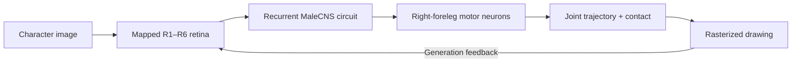

# FlyLM-3.1

**Character images in. Foreleg pen trajectories out. A fly connectome in between.**

FlyLM-3.1 explores next-character prediction through the reconstructed *Drosophila* nervous system. It presents images to mapped photoreceptors, propagates activity through the MaleCNS circuit, and converts right-foreleg motor activity into a drawing. During generation, that drawing becomes the next visual input.

| Train on Tiny Shakespeare | Load a run and generate pen drawings |
|:---:|:---:|
| [](https://colab.research.google.com/github/Chika1472/FlyLM/blob/main/flylm-3/flylm-3-1-train.ipynb) | [](https://colab.research.google.com/github/Chika1472/FlyLM/blob/main/flylm-3/flylm-3-1-infer.ipynb) |
| [Training source](flylm-3/flylm-3-1-train.ipynb) | [Inference source](flylm-3/flylm-3-1-infer.ipynb) |

The notebooks are self-contained. Training downloads its public corpus and connectome data; inference needs a complete saved FlyLM-3.1 run. The checked-in FlyLM-2 checkpoint uses a different architecture and cannot be loaded into these notebooks.

## Example videos

Click a preview to download the corresponding MP4 for playback. These are saved project demonstrations, not a completed evaluation of FlyLM-3.1 language learning.

| HELLO WORLD | SINGULARITY IS NEAR |
|:---:|:---:|
| [](https://github.com/Chika1472/FlyLM/raw/refs/heads/main/output/flylm_HELLO_WORLD.mp4) | [](https://github.com/Chika1472/FlyLM/raw/refs/heads/main/output/flylm_SINGULARITY_IS_NEAR.mp4) |
| [▶ Download video (MP4)](https://github.com/Chika1472/FlyLM/raw/refs/heads/main/output/flylm_HELLO_WORLD.mp4) | [▶ Download video (MP4)](https://github.com/Chika1472/FlyLM/raw/refs/heads/main/output/flylm_SINGULARITY_IS_NEAR.mp4) |
| [Interactive HTML replay](https://github.com/Chika1472/FlyLM/raw/refs/heads/main/flywrite3_27_HELLO_WORLD.html) | [Interactive HTML replay](https://github.com/Chika1472/FlyLM/raw/refs/heads/main/flywrite3_27_SINGULARITY_IS_NEAR.html) |

Download the HTML replays and open them locally for interactive playback. The inference notebook also exports a self-contained player with neural activity, retinal response, pen feedback, a 3D foreleg view, and playback controls.

## How FlyLM-3.1 works



The model retains the `Traced` neurons and their released connections from [MaleCNS v1.0](https://male-cns.janelia.org/download/). The locally checked graph contains **165,122 neurons and 25,563,197 directed edges**. Connectivity stays fixed while synaptic weights, type-shared dynamics and the motor-only pen readout are trained.

Mapped R1–R6 photoreceptors receive the external visual input. Mixed graded/spiking dynamics propagate it through the graph; the output head reads only right-foreleg motor signals. A differentiable two-link planar leg produces a 128-sample trajectory and pen contact. This is an engineered kinematic model, not a measured muscle or contact-physics simulation.

During training, the image of character `t` supervises a pen trace for character `t + 1`. During generation, the prompt is presented once and each predicted trace is rasterized for feedback. Recognized template labels are never substituted for the actual drawing fed to the eyes.

### Alphabet and objective

Tiny Shakespeare is cleaned **before** its 90/10 train/validation split:

- Convert lowercase to uppercase.
- Convert `?` and `!` to `.`.
- Convert whitespace, including line breaks, to spaces.
- Delete everything except `A–Z`, literal space and `.`; collapse repeated spaces and trim.

For example, `Don't, Romeo!\nGo?` becomes `DONT ROMEO. GO.`. The resulting alphabet has **28 symbols**. Space is drawn as `_` so that it remains visually distinguishable; underscore is not a separate corpus token. Inference uses the same cleaner.

The objective combines pen-tip MSE, contact BCE and next-character likelihood derived from distances to fixed pen templates:

```text
loss = tip_mse + 0.2 × contact_bce + 0.1 × template_nll
```

The model receives images rather than character IDs and has no learned vocabulary projection. Template likelihood and character accuracy are diagnostics of the produced trajectories; low geometric loss alone can still describe an unreadable average drawing.

## Train in Colab

1. Open the **training Colab button** above. Select **Runtime → Change runtime type → GPU**; an A100 is recommended when available. The setup prints the device actually assigned.
2. Review `CFG` in the configuration cell. Set `SAVE_TO_DRIVE=True` if you want persistent backups, then run the notebook from the top. No private corpus is required.
3. Let the numerical checks and full-graph preflight finish. They compare sparse implementations, measure memory and step time, and test that visual input affects the foreleg. Lower `batch_size` or `tbptt` and rerun from the top if the configured run exceeds your GPU memory budget.
4. After training, run the ZIP export cell. Download the complete run from Colab's Files sidebar, or set `DOWNLOAD_ZIP=True`. Rerun the export after generation and the controls report to include those later artifacts.

| Setting | Default |
|---|---|
| Batch size / TBPTT length | `32` / `16` characters |
| Neural ticks per character | `16` |
| Training budget | `1,000` optimizer updates |
| Optimizer / learning rate | Adam / `0.001`; fused Adam on CUDA |
| Dynamics / precision | Mixed graded/spiking / FP32 |
| Image / pen trajectory | `48 × 48` grayscale / `128` samples |
| Sparse backend | `auto`: validate and benchmark CSR/SDDMM against the reference |
| Activation checkpointing | Enabled |
| Validation / checkpoint interval | Every `100` updates, plus the final update |

The initial graph download is approximately 1.1 GB. Cache and active runs use the Colab VM's local disk:

```text
/content/flylm31_work/flylm_malecns_cache/
/content/flylm31_work/flylm31_runs/<run-id>/
```

With `SAVE_TO_DRIVE=True`, graph/visual assets are copied once and completed checkpoints are backed up to `/content/drive/MyDrive/FlyLM-3.1/runs/<run-id>`. Local VM files are temporary, so preserve the run through Drive or ZIP export. To resume, keep the matching configuration, mount Drive if needed, and set `RESUME_FROM` to the saved `latest.pt` before the training cell. Resume restores the optimizer, stream position, neural/retinal state and RNG state.

### Sparse optimization

FlyLM-3.1 uses CSR multiplication for state gradients and sampled dense-dense multiplication (SDDMM) for gradients at existing edges. It caches the transpose structure, refreshes transposed weights once per sequence, batches independent retinal/readout work, and reduces full-neuron allocations and metric transfers. The anatomical graph is not converted to A100's 2:4 structured sparsity. Recurrent arithmetic and losses stay FP32.

The notebook saves `sparse_benchmark.json` and `preflight.json` for the actual runtime. Its documented RTX 4060 Ti comparison reduced the median isolated training step from **12.83 s to 9.50 s** at batch 32 / TBPTT 16 / 16 ticks. That is a short local measurement, not an A100 benchmark or evidence of improved language learning.

## Run inference in Colab

1. Open the **inference Colab button** above and select a GPU runtime.
2. Extract a complete training ZIP into `/content`, or set `MOUNT_DRIVE=True` to access a Drive backup.
3. Set `BUNDLE_DIR` to the run directory containing `experiment.json`, then choose `CHECKPOINT_NAME='best.pt'` or `'latest.pt'` according to the file you saved. Point to the directory, not the ZIP.
4. Set `PROMPT` and `MAX_NEW_CHARACTERS`, then run the remaining cells. The default prompt is `ROMEO`; the default is 32 generated drawings and at most 240 recorded neural frames.

Example configuration for a Drive backup:

```python
MOUNT_DRIVE = True
BUNDLE_DIR = Path('/content/drive/MyDrive/FlyLM-3.1/runs/<run-id>')
CHECKPOINT_NAME = 'best.pt'
```

Keep these files together:

```text
<run-id>/
├── best.pt and/or latest.pt
├── experiment.json
├── asset_manifest.json
├── visual_pen_assets.pt
└── graph/
    └── saved connectivity, neuron IDs, dynamics and sensory/motor port arrays
```

The loader checks the `flylm3_1_visual_foreleg_v1` format, alphabet, asset hashes and checkpoint identity. Earlier FlyLM checkpoints need their corresponding inference notebooks.

Replays are saved under `/content/flylm31_replays`. Download the HTML for offline playback, including pause/seek, 0.1×–8× playback speed, anatomical views and PNG export. Set `SAVE_NUMERICAL_RECORDING=True` for additional NPZ/JSON exports. Replay speed changes the viewer only; it does not change simulated neural ticks or pen commands.

## Validation and interpretation

The notebooks document CPU/CUDA sparse-gradient checks, retinal and motor causality checks, activation-checkpoint checks, a full-graph preflight, and a two-update training/save/reload/inference smoke run. Colab backup/download branches were tested with mocked services. Hosted A100 execution and live Drive authorization were not part of those local checks.

For a training result, inspect the drawings alongside held-out metrics and the blank-retina, clamped-foreleg and train-only unigram controls. A low loss can reflect output averaging; successful replay/export does not establish language competence. Mixed spike trajectories can also vary across repeated GPU runs as small numerical differences cross thresholds.

## Earlier versions and research notes

| Version | Training | Inference | Scope |
|---|---|---|---|
| FlyLM-3 | [Notebook](flylm-3/flylm-3-training.ipynb) | [Notebook](flylm-3/flylm-3-inferance.ipynb) | Original visual next-character experiment |
| FlyLM-3 overfit test | [Notebook](flylm-3/FlyLM-3-overfit-test-training.ipynb) | [Notebook](flylm-3/FlyLM-3-overfit-test-inference.ipynb) | Controlled same-letter copy test |
| FlyLM-2 | [Notebook](flylm-2/flylm-2-training.ipynb) | [Notebook](flylm-2/flylm-2-inferance.ipynb) | SentencePiece text interface with mixed dynamics |
| FlyLM-1 | [Notebook](flylm-1/flylm-1-training.ipynb) | [Notebook](flylm-1/flylm-1-inferance.ipynb) | Earlier byte-level model |

Detailed FlyLM-1/2 equations, data preparation, checkpoint guidance and references are preserved in the [legacy technical reference](documents/flylm-1-2-reference.md). The [embodied-writing audit](documents/embodied-writing/connectome_audit.json) and [mushroom-body research plan](documents/mushroom-body-plan.md) provide additional context. The saved [FlyLM-2 bundle](flylm-2-model/README.txt) requires Git LFS and belongs to that earlier version.

## Sources and attribution

- [MaleCNS v1.0](https://male-cns.janelia.org/download/) supplies the connectivity and anatomical annotations.
- [Tiny Shakespeare](https://github.com/karpathy/char-rnn/blob/master/data/tinyshakespeare/input.txt) supplies the public character corpus.
- [doomfly](https://github.com/nftechie/doomfly) informs the retinal projection and luminance processing; attribution is included in the notebooks.
- [Connectome-constrained visual modeling](https://doi.org/10.1038/s41586-024-07939-3) provides relevant research precedent.
- [NVIDIA Ampere tuning](https://docs.nvidia.com/cuda/ampere-tuning-guide/index.html), [PyTorch sampled_addmm](https://docs.pytorch.org/docs/2.10/generated/torch.sparse.sampled_addmm.html), and the [Colab FAQ](https://research.google.com/colaboratory/faq.html) support the runtime choices.

The training notebook records data hashes, runtime versions, dynamics assumptions and additional references. The pen readout, kinematic leg, targets and template likelihood are engineering choices for this experiment.
