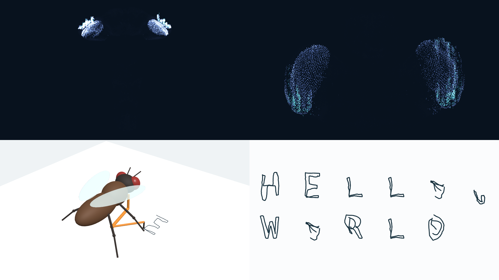
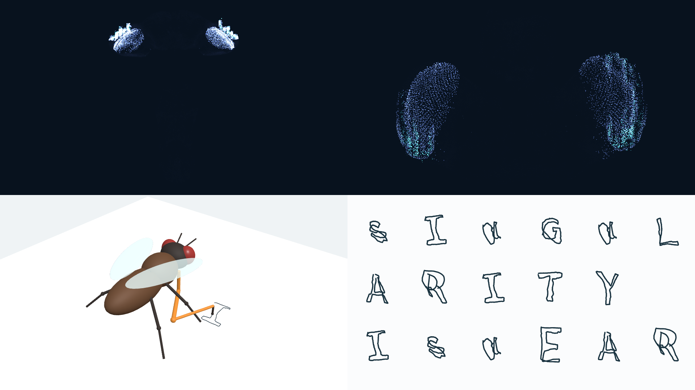
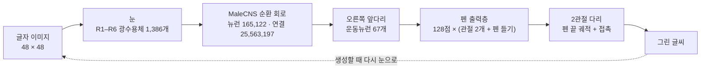

<a id="readme-top"></a>

<div align="center">

# FlyLM

**초파리의 실제 뇌 배선으로, 글자를 읽고 앞다리로 써 내는 언어모델을 만들 수 있을까?**

수컷 초파리 중추신경계 연결체(MaleCNS v1.0) 전체를 학습 가능한 순환 신경회로로 옮기고,<br>
눈으로 읽은 글에 이어질 글자를 오른쪽 앞다리로 직접 쓰는 **글씨 쓰는 언어모델**을 만들어 가는 실험 프로젝트

<sub>뉴런 165,122개 · 연결 25,563,197개 · 현재 버전 FlyLM-3.1 · Google Colab</sub>

<br>

[](flylm-3/flylm-3-1-train.ipynb)
[](flylm-3/flylm-3-1-train.ipynb)
[](#시작하기)
[](https://male-cns.janelia.org/download/)
[](flylm-2-model/README.txt)

[데모 보기](#데모) · [실행하기](#시작하기) · [폴더 안내](#저장소-구성) · [FlyLM-1/2 기술 문서](documents/flylm-1-2-reference.md)

</div>

<br>

> [!NOTE]
> **지금까지의 답** — 연결체 회로가 눈으로 본 글자를 오른쪽 앞다리로 **따라 쓸 수 있다**는 것을 확인했다. 대부분의 글자를 알아볼 수 있게 쓴다([데모](#데모)). 다음 단계는 이 글씨 쓰기를 언어모델과 합쳐 **읽은 글의 다음 글자를 직접 쓰게 하는 것**이다. 이를 위한 FlyLM-3.1 노트북은 전체 그래프에서 동작 점검까지 마쳤고, 본 학습은 아직 진행하지 않았다.

<details>
<summary><b>목차</b></summary>

1. [한눈에 보기](#한눈에-보기)
2. [프로젝트 소개](#프로젝트-소개)
3. [데모](#데모)
4. [작동 방식](#작동-방식)
5. [검증과 현재 상태](#검증과-현재-상태)
6. [이전 버전](#이전-버전)
7. [저장소 구성](#저장소-구성)
8. [시작하기](#시작하기)
9. [설계 원칙](#설계-원칙)
10. [한계](#한계)
11. [로드맵](#로드맵)
12. [참고자료](#참고자료)

</details>

---

## 한눈에 보기

| 구분 | 내용 |
|---|---|
| **질문** | 실제 초파리의 신경 연결 구조를 그대로 둔 회로가 글자를 보고, 다음 글자를 앞다리 펜 궤적으로 쓰도록 학습될 수 있는가? |
| **회로** | MaleCNS v1.0의 `Traced` 뉴런 165,122개와 그 사이의 방향성 연결 25,563,197개 전체. 가지치기나 표본 추출 없음 |
| **입력 (눈)** | 48×48 흑백 글자 이미지 → 화면 좌표가 매핑된 R1–R6 광수용체 1,386개 |
| **출력 (앞다리)** | 오른쪽 앞다리(T1) 운동뉴런 67개 → 2관절 다리의 128점 펜 궤적과 펜 접촉 |
| **데이터** | Tiny Shakespeare를 A–Z·띄어쓰기·마침표 28자로 정제한 1,066,216자. 앞 90% 학습, 뒤 10% 검증 |
| **학습** | 연결 구조는 고정하고 시냅스 가중치, 세포 유형별 동역학, 운동뉴런 → 펜 출력층을 학습. 스파이크/연속 혼합 동역학, 대리 미분, TBPTT, Adam |
| **실행 환경** | Google Colab GPU (A100 권장). 모든 코드가 노트북 하나에 들어 있다 |
| **진행** | 글씨 쓰기 확인 완료 · 언어모델 결합(FlyLM-3.1) 노트북 준비와 동작 점검 완료 · 본 학습 전 |

<p align="right"><a href="#readme-top">맨 위로 ↑</a></p>

---

## 프로젝트 소개

### 왜 이 연구를 하나

초파리 성체 수컷의 중추신경계 전체가 시냅스 수준에서 재구성되어 공개되었다([MaleCNS v1.0](https://male-cns.janelia.org/download/)). 어느 뉴런이 어느 뉴런에게 몇 개의 시냅스로 신호를 보내는지까지 알 수 있는, 실제 동물의 뇌 배선도다.

이 배선도를 뼈대로 그대로 두고 연결 세기와 뉴런의 반응 특성만 학습시키면, 언어처럼 순서가 있는 과제를 풀 수 있을까? FlyLM은 실제 신경 구조가 순서 학습에 쓸모 있는 **구조적 사전지식**이 되는지, 그리고 생물학적 제약을 더하면 행동이 어떻게 달라지는지를 실험으로 확인한다. 연결체에 제약을 건 채 과제를 최적화하는 방식은 초파리 시각계 모델링에 선례가 있다([Lappalainen et al., 2024](https://doi.org/10.1038/s41586-024-07939-3)). FlyLM은 이 방식을 언어 과제로 옮긴다.

처음 두 버전(FlyLM-1/2)은 텍스트 토큰을 감각뉴런 전류로 바꾸고, 운동뉴런 활동을 다시 토큰으로 읽는 학습된 변환기를 썼다. 이 구조에서 언어는 사람이 만든 입출력 어댑터를 거쳐 회로에 들어가고 나온다. FlyLM-3부터는 이 어댑터를 없애고 파리가 실제로 가진 기관을 쓴다. 글자는 **눈**으로 읽고, 대답은 **앞다리**로 쓴다.

이 프로젝트는 초파리에게 언어 능력이 있다고 주장하지 않는다. 언어는 실제 회로의 계산 능력을 시험하기 위한 공학적 과제이고, 눈의 화면 매핑과 펜 역할을 하는 다리 모델은 이 실험을 위해 설계한 인터페이스다.

### 연구 질문

| 구분 | 질문 | 상태 |
|---|---|---|
| **Q1 신호 전달** | 눈에 들어온 이미지가 전체 연결체를 지나 앞다리 운동뉴런의 활동을 바꾸는가? | 확인 |
| **Q2 글씨 쓰기** | 앞다리 운동뉴런만 읽어서, 본 글자를 알아볼 수 있는 글씨로 쓸 수 있는가? | 확인 |
| **Q3 다음 글자 쓰기** | 회로에 쌓인 시각 이력으로 다음 글자를 예측해 쓸 수 있는가? | 준비 완료, 학습 전 |
| Q4 생물학적 제약 | 스파이크/연속 혼합 동역학은 모든 뉴런을 연속으로 둔 대조군과 무엇이 다른가? | 선택 |

Q3의 가설은 "연결체를 따라 전파된 시각 이력이 검증 구간의 다음 글자 궤적 오차와 템플릿 NLL을 줄인다"는 것이다. 궤적 오차만 낮으면 여러 후보 글자를 평균한, 읽을 수 없는 그림일 수 있으므로 두 지표를 함께 본다.

### 단계별로 만든다

| 단계 | 내용 | 산출물 | 상태 |
|---|---|---|---|
| ① 연결체 언어모델 | 전체 연결체 위에서 텍스트의 다음 토큰 예측 | FlyLM-1(바이트), FlyLM-2(SentencePiece·혼합 동역학, 학습된 번들) | 완료 |
| ② 눈과 앞다리 | 텍스트 변환기를 없애고 R1–R6 시각 입력과 오른쪽 앞다리 펜 출력을 연결 | FlyLM-3 노트북, 3D 재생기 | 완료 |
| ③ 글씨 쓰기 확인 | 본 글자를 같은 글자로 따라 쓰기 | A/B/C 따라 쓰기 노트북, 글씨 쓰기 데모 | 완료 |
| ④ 언어모델과 결합 | 읽은 글자의 다음 글자를 펜으로 쓰도록 학습 | FlyLM-3.1 학습·추론 노트북 | 노트북 준비, 본 학습 전 |
| ⑤ 평가와 확장 | 대조 실험으로 언어 학습 여부 판단, 버섯체 동역학·가소성 | 평가 결과, [버섯체 연구 계획](documents/mushroom-body-plan.md) | 예정 |

<p align="right"><a href="#readme-top">맨 위로 ↑</a></p>

---

## 데모

보여 준 글자를 오른쪽 앞다리가 따라 쓰는 **글씨 쓰기 확인** 기록이다. 글자 이미지를 한 글자씩 눈에 보여 주면, 전체 연결체를 지난 앞다리 운동뉴런의 활동이 펜 궤적으로 바뀐다. 미리보기를 누르면 MP4를 내려받는다.

| HELLO WORLD | SINGULARITY IS NEAR |
|:---:|:---:|
| [](https://github.com/Chika1472/FlyLM/raw/refs/heads/main/output/flylm_HELLO_WORLD.mp4) | [](https://github.com/Chika1472/FlyLM/raw/refs/heads/main/output/flylm_SINGULARITY_IS_NEAR.mp4) |
| [▶ 영상 내려받기 (MP4, 29초)](https://github.com/Chika1472/FlyLM/raw/refs/heads/main/output/flylm_HELLO_WORLD.mp4) | [▶ 영상 내려받기 (MP4, 49초)](https://github.com/Chika1472/FlyLM/raw/refs/heads/main/output/flylm_SINGULARITY_IS_NEAR.mp4) |
| [HTML 재생기 내려받기](https://github.com/Chika1472/FlyLM/raw/refs/heads/main/flywrite3_27_HELLO_WORLD.html) | [HTML 재생기 내려받기](https://github.com/Chika1472/FlyLM/raw/refs/heads/main/flywrite3_27_SINGULARITY_IS_NEAR.html) |

| 화면 | 보이는 것 |
|---|---|
| 위 | 뉴런 165,122개 전체의 활동. 실제 해부학적 좌표를 두 방향에서 본 모습 |
| 왼쪽 아래 | 3D 파리. 주황색 오른쪽 앞다리가 기록된 관절 각도와 펜 접촉을 따라 움직인다 |
| 오른쪽 아래 | 앞다리가 실제로 그린 궤적. 인식한 글자나 깨끗한 글꼴로 바꿔 넣지 않았다 |

- **설정** — 글자마다 신경·망막 상태를 0에서 시작해 16 tick 동안 이미지를 보여 주고, 앞다리 운동뉴런 67개의 활동에서 128점 궤적을 읽는다. 전체 그래프와 매핑된 광수용체 1,386개를 그대로 쓰고, 띄어쓰기는 `␣` 모양 이미지로 보여 준다.
- **결과** — H·E·L·W·R·D·I·G·A·T·Y처럼 대부분의 글자는 알아볼 수 있게 쓴다. O·N·U·S와 띄어쓰기는 아직 형태가 무너진다. 결과를 고르거나 다듬지 않고 그대로 보여 준다.
- **HTML 재생기** — GitHub에서는 소스로만 보이므로 내려받아(28MB, 35MB) Chrome이나 Edge로 연다. 인터넷 없이 재생되며 재생·일시정지·탐색, 0.1×–8× 속도, 두 방향 보기와 3D 회전, 4K PNG 저장을 지원한다.

> [!NOTE]
> 이 데모는 **글씨를 쓸 수 있는지 확인하는 단계**의 결과다. 보여 준 글자를 그대로 따라 쓰는 과제이고, 다음 글자를 예측해 쓰는 언어모델과의 결합(FlyLM-3.1)은 아직 학습하지 않았다. 저장소에는 데모 결과(HTML·MP4)가 들어 있으며, 같은 방식의 학습 코드는 A/B/C로 범위를 줄인 [따라 쓰기 테스트 노트북](flylm-3/FlyLM-3-overfit-test-training.ipynb)에서 볼 수 있다.

<p align="right"><a href="#readme-top">맨 위로 ↑</a></p>

---

## 작동 방식

현재 버전인 FlyLM-3.1 기준이다. 모든 구현은 [학습 노트북](flylm-3/flylm-3-1-train.ipynb) 하나에 들어 있다.

### 전체 흐름



학습할 때는 글자 t의 이미지를 보여 주고 글자 t+1의 궤적을 정답으로 쓴다. 생성할 때는 프롬프트 글자를 차례로 한 번씩 보여 준 뒤, 예측한 궤적을 이미지로 그려 다음 입력으로 되먹인다. 인식한 글자를 깨끗한 글꼴로 바꿔 넣지 않는다.

### 1. 연결체: 가지치기 없는 전체 그래프

- MaleCNS v1.0 공식 파일 세 개(뉴런 주석 14.5MB, 신경전달물질 43.3MB, 연결 1.05GB)를 내려받고 크기와 SHA-256을 기록한다.
- `status == 'Traced'`인 뉴런 165,122개를 `bodyId` 순으로 정렬하고, 이들 사이의 연결 25,563,197개를 **모두** 유지한다. 같은 뉴런 쌍의 시냅스 수는 합치고, 자기 연결과 떨어진 성분도 버리지 않는다.
- 연결 파일을 두 번 훑어 디스크 위에 CSR 행렬(행 = 시냅스 후 뉴런, 열 = 시냅스 전 뉴런)을 만든다. 원본 연결 표 전체를 메모리에 올리지 않는다.

### 2. 눈과 앞다리: 실제 감각·운동 뉴런만 사용

- **눈** — [doomfly](https://github.com/nftechie/doomfly)의 방식을 따라, 각 R1–R6 광수용체가 연결된 L1/L2/L3 뉴런의 육각 기둥 좌표 중 시냅스가 가장 많은 기둥을 골라 화면 좌표로 바꾼다. 매핑된 광수용체는 1,386개(R1–R6 전체 1,394개)이고, 왼쪽·오른쪽 눈은 겹치는 두 화면 영역에 대응한다. 실제 눈의 광학을 보정한 것이 아니라 화면 좌표를 추정한 것이다.
- **망막 처리** — 픽셀을 sRGB에서 선형 밝기로 바꾸고 3×3 평균을 낸 뒤 각 광수용체 위치에서 샘플링한다. 시간 저역 통과(τ = 4 tick)와 포화 $gL/(0.02+L)$를 거쳐 광수용체 전류가 된다. 라미나(L1/L2/L3/L5)에는 이미지와 무관한 휴지 입력 0.30을 더한다.
- **앞다리** — `superclass == vnc_motor`, `subclass == fl`, `somaSide == R`, `somaNeuromere == T1`인 오른쪽 앞다리 운동뉴런 67개만 읽는다. 망막에서 이 뉴런들까지 가는 경로가 없으면 실행을 멈춘다.
- 외부 입력은 광수용체에만 들어간다. 다른 감각뉴런은 회로 안에 남아 있지만 외부 자극을 받지 않는다.

### 3. 시냅스 가중치

연결 $j \rightarrow i$의 시냅스 수를 $c_{ij}$라 하면, 고정된 사전값 $p_{ij}$와 실제 가중치 $w_{ij}$는 다음과 같다.

$$
p_{ij}=\frac{\log(1+c_{ij})}{\sum_{k\rightarrow i}\log(1+c_{ik})},\qquad
w_{ij}=p_{ij}
\begin{cases}
\eta_j\left(0.25+3.75\,\sigma(\theta_{ij})\right), & \eta_j\in\{-1,+1\}\\
4\tanh(\theta_{ij}), & \eta_j=0
\end{cases}
$$

- $\theta_{ij}$는 연결마다 하나씩 있는 학습 파라미터다. 연결 구조와 사전값 $p_{ij}$는 바뀌지 않는다.
- 부호 $\eta_j$는 시냅스 전 뉴런의 신경전달물질에서 온다. 실측(ground truth) 주석을 우선하고, 없으면 신뢰도 0.8 이상인 예측을 쓴다. 아세틸콜린은 흥분(+1), GABA와 히스타민은 억제(−1)로 두고, 나머지 전달물질과 미확인 뉴런은 부호까지 학습한다($\eta_j=0$). 수용체 수준의 전도도 모델이 아닌 근사다.

### 4. 신경 동역학

각 뉴런은 막전위 $v$, 시냅스 출력 $s$, 느린 적응 $a$, 남은 불응기 $q$의 네 상태를 가진다. 매 tick마다 다음을 계산한다. 외부 입력 $u$는 광수용체와 라미나에만 있고, 각 필터 계수는 $\alpha=1-e^{-1/\tau}$이다.

$$
I_i=\sum_{j\rightarrow i} w_{ij}\,s_j+u_i,\qquad
\tilde v_i=v_i+\alpha_{m}\left(-v_i+I_i-\beta\,a_i\right)
$$

- **연속(graded) 뉴런** — $r=\max(0,\tanh(\tilde v-h))$만큼 신호를 낸다.
- **스파이크 뉴런** — $\tilde v$가 역치 $h$ 이상이면 스파이크($z=1$)를 내고, 막전위를 0으로 되돌린 뒤 2 tick 동안 다시 발화하지 않는다. 순전파는 이산 사건이고, 역전파에서만 대리 미분 $1/(1+5|\tilde v-h|)^2$를 쓴다.
- $s$와 $a$는 방출량($r$ 또는 $z$)을 각각 빠르게, 느리게 따라간다. 앞다리 출력층이 읽는 값은 $s$다.
- 시간 상수 3개, 역치, 적응 강도는 세포 유형별로 공유하며 학습한다. 유형 주석이 없으면 `class`, `superclass` 순으로 묶는다.

<details>
<summary><b>스파이크/연속 배정 근거와 동역학 기본값</b></summary>

<br>

MaleCNS에는 뉴런별 발화 방식 표가 없다. 아래 근거집은 MaleCNS `type`과 **정확히 같은 이름**에만 적용하고, 부분 문자열이나 상위 분류로 넓히지 않는다.

| MaleCNS 유형 | 방식 | 근거 |
|---|---|---|
| `H2` | 스파이크 | [Zhao et al., 2025](https://doi.org/10.1038/s41586-025-09276-5) — H2 전기생리 기록 |
| `DM1_lPN` | 스파이크 | [Gouwens & Wilson, 2009](https://doi.org/10.1523/JNEUROSCI.0764-09.2009) — DM1 투사뉴런 활동전위 (암컷 → 수컷 대응 가정) |
| `HSN`, `HSE`, `HSS` | 연속 | [Pokusaeva et al., 2024](https://doi.org/10.1038/s41467-024-53173-w) — 수컷 HS 막전위 기록 |
| `R1-R6` | 연속 | [Juusola et al., 2016](https://doi.org/10.3791/54142) — 광수용체 전압 기록 |
| `L1`, `L2`, `L3`, `L5` | 연속 | 시각 모델 가정 ([Lappalainen et al., 2024](https://doi.org/10.1038/s41586-024-07939-3)), FlyLM-3에서 추가 |
| 그 밖의 유형 | 스파이크 | 근거 없는 **기본값**. 실제로 스파이크를 낸다는 측정 결과가 아니다 |

근거가 있는 유형은 일부뿐이라 대부분의 뉴런은 기본값으로 실행된다. 모든 뉴런을 연속으로 바꾼 대조 조건(`neuron_mode='graded_control'`)도 준비되어 있다. 근거·대응 가정·한계는 실행마다 `dynamics_evidence.json`, `neuron_activity_annotations.csv`로 저장된다.

| 항목 | 초기값 | 범위 |
|---|---:|---|
| 막 / 시냅스 / 적응 시간 상수 | 2 / 2 / 64 tick | 0.5–32 / 0.5–16 / 8–512 tick |
| 적응 강도 | 0.1 | 0–1 |
| 스파이크 역치 | 0.01 | 0.01 ± 0.008 |
| 연속 역치 | 0 | ±0.5 |
| 리셋 전압 / 불응기 | 0 / 2 tick | 고정 |
| 글자당 tick | 16 | 고정 |

모든 수치는 공학적 설정이며 생리학 측정값이 아니다. tick은 밀리초가 아니다.

</details>

### 5. 앞다리 펜 출력

- 글자 하나를 16 tick 동안 본 뒤, 운동뉴런 67개의 $s$를 LayerNorm(학습 파라미터 없음)으로 정규화하고 선형층 하나(67 → 384)로 128개 시점의 (관절 1, 관절 2, 펜 들기) 명령을 만든다.
- 관절 각도를 범위 안으로 제한한 뒤(관절 1: −1.8 ~ 1.0, 관절 2: 0.2 ~ 2.8), 두 마디 길이가 0.8인 평면 다리의 순운동학으로 펜 끝 위치를 계산한다. 펜 들기 값은 펜 접촉 확률이 된다.
- 출력층은 앞다리 운동뉴런만 본다. 이미지·정답·다른 뉴런을 직접 읽는 지름길은 없다. 128점 궤적은 출력층이 한 번에 만들고(open-loop), 그동안 회로를 더 시뮬레이션하지 않는다.
- 근육·마찰·접촉력은 모델링하지 않는다. 실제 다리의 물리 시뮬레이션이 아니라 미분 가능한 운동학 대리 모델이다.

| 고정 | 학습 |
|---|---|
| 뉴런 집합과 연결 구조, 시냅스 수 사전값, 전달물질 부호 | 연결마다 하나의 가중치 파라미터 $\theta_{ij}$ (25,563,197개) |
| 망막 매핑, 앞다리 운동뉴런 선택, 스파이크/연속 배정 | 세포 유형별 시간 상수·역치·적응 강도 |
| 다리 길이와 관절 범위, 글자별 목표 궤적 | 운동뉴런 → 펜 출력층 (67 → 384 선형층) |

### 6. 데이터와 학습 목표

[Tiny Shakespeare](https://github.com/karpathy/char-rnn/blob/master/data/tinyshakespeare/input.txt) 원문(1,115,394자)을 **분할하기 전에** 다음 규칙으로 정제한다. 추론 프롬프트도 같은 규칙을 거친다.

1. 대문자로 바꾼다.
2. `?`와 `!`를 `.`으로 바꾼다.
3. 줄바꿈을 포함한 모든 공백을 띄어쓰기로 바꾼다.
4. `A–Z`, 띄어쓰기, `.` 외의 문자를 지우고, 연속된 띄어쓰기를 하나로 줄이고 양끝을 다듬는다.

예를 들어 `Don't, Romeo!\nGo?`는 `DONT ROMEO. GO.`가 된다. 결과는 28자 알파벳의 1,066,216자이고, 앞 90%를 학습, 뒤 10%를 검증에 쓴다.

- **목표 궤적** — 글자마다 DejaVu Sans Mono 글꼴의 외곽선을 따라가는 128점 궤적을 만든다. 윤곽마다 펜을 든 채 시작점으로 이동한 뒤 외곽선을 그린다. 손글씨 데이터나 문자 인식기는 쓰지 않는다.
- **띄어쓰기** — 눈으로 구분할 수 있도록 `_` 모양으로 그린다. `_`는 별도 글자가 아니다.
- **학습 흐름** — 학습 텍스트를 이어진 32개 흐름으로 나누고 16자씩 잘라 학습한다(TBPTT). 신경·망막 상태는 다음 구간으로 이어지고, 흐름이 처음으로 돌아갈 때만 초기화한다.

```text
loss = 펜 끝 위치 MSE + 0.2 × 펜 접촉 BCE + 0.1 × 템플릿 NLL
```

템플릿 NLL은 예측 궤적과 28개 고정 템플릿 궤적 사이의 거리로 만든 분포(온도 0.03)에서 정답 글자의 음의 로그우도다. 학습 가능한 어휘 출력층은 없다. 모델에는 글자 번호가 아닌 이미지만 들어가고, 글자 번호는 데이터를 관리하는 데만 쓴다.

<details>
<summary><b>A100을 위한 희소 연산 최적화</b></summary>

<br>

- 순전파는 CSR 희소 행렬과 밀집 행렬의 곱이다. 뉴런 × 뉴런 밀집 행렬은 만들지 않는다.
- 역전파에서 입력 기울기는 전치 CSR 곱으로, 가중치 기울기는 존재하는 연결 위치에서만 계산하는 SDDMM([`torch.sparse.sampled_addmm`](https://docs.pytorch.org/docs/2.10/generated/torch.sparse.sampled_addmm.html))으로 구한다.
- 전치 구조는 한 번만 준비하고 전치 가중치는 시퀀스마다 한 번 갱신한다. 인덱스는 32비트다.
- 망막 전처리와 펜 출력은 시간축 전체를 한 번에 처리하고, 지표 5개는 한꺼번에 CPU로 옮긴다.
- 모든 계산은 FP32다. 해부학 그래프를 A100의 2:4 구조적 희소성으로 바꾸거나 가지치기하지 않는다.
- `sparse_backend='auto'`는 실제 GPU에서 기준 구현과 CSR/SDDMM 구현의 결과를 대조하고 속도를 재서 빠른 쪽을 고른다. 결과는 `sparse_benchmark.json`과 `preflight.json`에 남는다.

| 학습 1스텝 (RTX 4060 Ti, batch 32 / TBPTT 16 / 16 tick) | 개정 전 3.1 | Colab 개정판 |
|---|---:|---:|
| 중앙값 (워밍업 뒤 3스텝) | 12.83초 | 9.50초 |
| 최대 GPU 메모리 | 5.98 GiB | 5.64 GiB |

로컬에서 잰 짧은 측정이며, A100 결과나 학습 성능이 좋아졌다는 증거가 아니다.

</details>

<p align="right"><a href="#readme-top">맨 위로 ↑</a></p>

---

## 검증과 현재 상태

| 단계 | 무엇을 확인했나 | 결과 |
|---|---|---|
| ① 구조적 경로 | 망막에서 운동뉴런까지 방향 그래프의 최단 경로 | R1–R6에서 출력 포트 815개 모두 3–5단계 안에 도달, T1 운동뉴런 후보 173개 모두 4–5단계 안에 도달 |
| ② 구현 정확성 | 희소 연산·대리 미분·체크포인트 재계산을 밀집 기준 구현과 비교 (CPU·CUDA) | 모두 일치 |
| ③ 시각 → 운동 인과성 | 실제 이미지와 빈 망막 비교, 글자 사이 망막 반응 구분, 출력층이 운동뉴런만 읽는지 확인 | 통과 |
| ④ **글씨 쓰기** | 본 글자를 같은 글자로 따라 쓰기 | 대부분의 글자를 알아볼 수 있게 씀 ([데모](#데모)) |
| ⑤ 전체 파이프라인 | 학습 2회 → 검증 → 저장 → 재로드 → 생성 → 재생 HTML | 통과 |
| ⑥ **다음 글자 쓰기** | 본 학습(1,000 업데이트)과 대조 평가 | 진행 전 |

<details>
<summary><b>① 연결체 구조 감사</b></summary>

<br>

[`audit_connectome.py`](documents/embodied-writing/audit_connectome.py)가 FlyLM-2 그래프 배열과 원본 주석을 대조해 [`connectome_audit.json`](documents/embodied-writing/connectome_audit.json)을 만든다.

- 입력 포트 15,896개, 출력 포트 815개(`vnc_motor` 708, `cb_motor` 107)
- 시각 감각뉴런 4,114개 중 R1–R6 1,394개(`rootSide` 기준 왼쪽 501, 오른쪽 893)
- R1–R6 → L1–L5 연결 쌍 4,736개
- 뉴런 목록: [`visual_sensory_inventory.csv`](documents/embodied-writing/visual_sensory_inventory.csv), [`T1_motor_candidates.csv`](documents/embodied-writing/T1_motor_candidates.csv)(오른쪽 앞다리 `fl` 67개 포함)
- 가중치 없는 구조적 도달성이라 시냅스 세기·부호·지연과 학습된 동역학은 반영하지 않는다. T1 후보에는 다리가 아닌 근육의 운동뉴런도 섞여 있다.
- 다시 실행하려면 Git LFS로 그래프 배열을 받고, MaleCNS 주석 파일을 `tmp/mb-research/`에 둔다.

</details>

<details>
<summary><b>②③⑤ 구현과 파이프라인 점검 (2026-09-12)</b></summary>

<br>

학습·추론 노트북 끝의 개발 점검 기록을 요약했다. 로컬 RTX 4060 Ti(8 GiB), PyTorch 2.10.0+cu126 결과이며 A100이나 Colab에서 잰 값이 아니다.

- CPU·CUDA 희소 연산의 출력과 두 기울기가 밀집 기준과 일치했다(부호·0 가중치, 빈 행/열, 배치 1/7/32 포함). float64 유한차분 검사와 체크포인트 재계산도 통과했다.
- 연속 대조 조건에서 개정 전 구현과 출력·상태·기울기가 FP32 허용 오차 안에서 일치했다(펜 위치 최대 차이 4.18×10⁻⁷).
- 전체 그래프 사전 점검: 최대 메모리 5.46 GiB, 0이 아닌 시냅스 기울기, 글자마다 다른 망막 반응, 시각 → 운동 경로 작동.
- 학습 2회 → 검증 → best/latest 저장 → 엄격한 재로드 → 생성 → 애니메이션 → 대조 실험까지 마쳤고, 실행 ZIP의 내용과 CRC 검사도 통과했다.
- 추론 노트북은 이 체크포인트로 그림 4개를 384 tick, 64 프레임에 걸쳐 기록했다. 기록 중 계산은 일반 추론과 일치했고, 되먹임 이미지는 학습 때의 래스터화 결과와 정확히 같았다.
- Colab의 Drive 백업·다운로드 분기는 모의 서비스로 점검했다. 실제 Drive 인증과 A100 실행은 확인하지 않았다.

</details>

> [!TIP]
> **학습 결과를 읽는 법** — 손실값 하나로 판단하지 않는다. 실제로 그린 글씨, 검증 지표, 그리고 세 가지 대조(빈 망막, 앞다리 신호 차단, 학습 데이터 유니그램 NLL)를 함께 본다. 평균 궤적으로 무너진 출력도 손실은 낮을 수 있고, 재생 HTML이 잘 만들어졌다는 것이 언어 능력을 뜻하지는 않는다.

<p align="right"><a href="#readme-top">맨 위로 ↑</a></p>

---

## 이전 버전

| 버전 | 입력 → 출력 | 동역학 | 데이터 | 실행 환경 | 노트북 |
|---|---|---|---|---|---|
| **FlyLM-3.1** | 글자 이미지 → 다음 글자 펜 궤적 | 혼합 | Tiny Shakespeare 28자 | Colab (A100) | [학습](flylm-3/flylm-3-1-train.ipynb) · [추론](flylm-3/flylm-3-1-infer.ipynb) |
| FlyLM-3 | 글자 이미지 → 다음 글자 펜 궤적 | 혼합 | Tiny Shakespeare 원문 문자 | Kaggle (P100) | [학습](flylm-3/flylm-3-training.ipynb) · [추론](flylm-3/flylm-3-inferance.ipynb) |
| FlyLM-3 따라 쓰기 | A/B/C 이미지 → 같은 글자 펜 궤적 | 혼합 | A/B/C | Kaggle (T4 ×2) | [학습](flylm-3/FlyLM-3-overfit-test-training.ipynb) · [추론](flylm-3/FlyLM-3-overfit-test-inference.ipynb) |
| FlyLM-2 | SentencePiece 토큰 → 다음 토큰 | 혼합 | 한국어 대화 (비공개) | Kaggle (P100) | [학습](flylm-2/flylm-2-training.ipynb) · [추론](flylm-2/flylm-2-inferance.ipynb) |
| FlyLM-1 | UTF-8 바이트 → 다음 바이트 | 연속 | 한국어 대화 (비공개) | Kaggle (P100) | [학습](flylm-1/flylm-1-training.ipynb) · [추론](flylm-1/flylm-1-inferance.ipynb) |

버전마다 체크포인트 형식이 달라 서로 호환되지 않는다. 체크포인트는 그 버전의 추론 노트북으로 연다.

<details>
<summary><b>FlyLM-3 — 처음 만든 시각 입력·펜 출력 모델</b></summary>

<br>

- 구조는 3.1과 같다. Tiny Shakespeare의 원문 문자(대소문자, 문장부호, 띄어쓰기, 줄바꿈)를 그대로 쓰고, 띄어쓰기는 `␣`, 줄바꿈은 `↵` 모양으로 그린다.
- 기본값은 batch 2, TBPTT 16, 글자당 16 tick, 1,000 업데이트다. Kaggle P100에서 `sm_60`을 지원하는 PyTorch 2.10.0(CUDA 12.6) 빌드를 확인하고, 없을 때만 설치한다.
- 개발 점검(RTX 4060 Ti, 2회 업데이트): 전체 그래프, 망막 매핑 1,386개, 앞다리 운동뉴런 67개를 확인했고 모든 운동뉴런이 망막에서 도달 가능했다. 사전 점검의 최대 GPU 메모리는 약 1.47 GiB였다. 2회 업데이트는 동작 점검용이라 글씨 품질 평가에는 쓰지 않는다.

</details>

<details>
<summary><b>FlyLM-3 따라 쓰기 테스트 — A/B/C를 보고 같은 글자 쓰기</b></summary>

<br>

- **질문** — A, B, C 이미지가 전체 회로를 지나 앞다리로 같은 글자를 쓰게 만들 수 있는가? 다음 글자 예측이 아니라 경로를 검증하는 과적합 실험이며, [데모](#데모)와 같은 '보고 따라 쓰기' 방식이다.
- 매 예시마다 신경·망막 상태를 0에서 시작하고, 업데이트마다 세 글자를 섞어 한 번씩 보여 준다. 글자 번호는 정답을 고를 때만 쓰고 회로에는 들어가지 않는다.
- **2단계 학습** — ① 학습하지 않은 회로의 운동뉴런 활동을 저장해 두고 펜 출력층만 학습한다(300회). ② 전체 회로를 다시 계산하며 모든 파라미터를 학습한다(최대 200회, 회로 학습률 1e-7, 출력층 3e-4).
- **성공 기준** — 평균 궤적 대비 위치 오차 5% 미만(글자별 10% 미만), 펜 접촉 재현율 98% 이상, 펜 들기 재현율 95% 이상. 빈 이미지, 모두 A, 순서를 바꾼 이미지, 운동 신호 차단 대조에서는 구분 능력이 사라져야 한다.
- Kaggle T4 두 장에서 데이터 병렬로 학습한다(GPU당 3개, 전체 배치 6). 추론 노트북은 한 장의 GPU나 CPU에서 같은 3D 재생기로 결과를 보여 준다.

</details>

<details>
<summary><b>FlyLM-2 — SentencePiece와 스파이크/연속 혼합 동역학</b></summary>

<br>

- 한국어 대화 JSON 14,229개에서 두 화자의 인접한 질문–답변 쌍을 만든다. 문서 단위 95:5 분할로 학습 331,601쌍, 검증 17,687쌍이다.
- 학습 쌍 10만 개로 SentencePiece Unigram 어휘 4,096개(바이트 fallback 256개 포함)를 학습한다.
- 입력은 토큰 임베딩(32차원) → 감각뉴런 15,896개의 전류, 출력은 운동뉴런 815개 → LayerNorm → 임베딩을 공유하는 어휘 출력층이다. 토큰당 4 tick, TBPTT 64이고 답변 토큰에만 손실을 준다.
- 문헌 근거가 있는 뉴런은 1,404개(0.85%)이고, 나머지 163,718개는 스파이크 기본값으로 실행된다.
- 학습된 추론 번들이 [`flylm-2-model/`](flylm-2-model/README.txt)에 있다(Git LFS). 추론 노트북의 생성 예시는 한국어 단어 조각이 이어지는 수준으로, 대화 능력은 확인되지 않았다.
- 수식·데이터 처리·출력물의 자세한 설명은 [FlyLM-1/2 기술 문서](documents/flylm-1-2-reference.md)에 있다.

</details>

<details>
<summary><b>FlyLM-1 — 바이트 언어모델</b></summary>

<br>

- 같은 대화 데이터를 UTF-8 바이트(어휘 258개)로 학습한다. 뉴런 상태는 $v, s, a$ 세 값이고 모두 연속 동역학이다.
- Kaggle P100에서 batch 2로 1,000 업데이트(약 2.6시간)를 학습했다. 검증 4쌍의 답변 손실은 8.86 → 2.10(퍼플렉서티 7,080 → 8.1)으로 줄었다.
- 생성된 답은 아직 의미 있는 문장이 아니었다. 검증 4쌍은 실행 점검용이라 성능 결론에 쓰지 않는다.
- 추론 노트북에는 165,122개 뉴런 전체의 활동을 해부학적 위치에 그리는 2D 재생기가 들어 있다(세포체 140,024개 + 골격 대표점 25,098개).

</details>

<details>
<summary><b>초기 실험 — <code>archived/</code></b></summary>

<br>

| 파일 | 내용 |
|---|---|
| `flylm_t4_feasibility.ipynb` | 합성 16뉴런 그래프로 attention 없는 다음 토큰 예측이 가능한지 점검 |
| `flylm_malecns_8192_t4.ipynb` | MaleCNS 뉴런 8,192개 부분 그래프, 한국어 바이트 모델(Colab T4). 같은 글자만 되풀이하는 문제가 드러남 |
| `flylm_malecns_full_t4.ipynb` | 전체 `Traced` 뉴런과 감각 15,896개 → 운동 815개 포트로 확장, 반복 출력의 원인 분석 |
| `flylm_malecns_dynamics_t4.ipynb` | 뉴런 상태 $v, s, a$의 연속 동역학 도입 |
| `flylm_malecns_dynamics_p100.ipynb` | Kaggle P100용 버전. FlyLM-1의 바탕 |
| `flylm_inference.ipynb`, `flylm_inference.py`, `flylm_activity.py` | 바이트 모델 추론 모듈과 뉴런 활동 2D 재생기 |
| `check_activity.py`, `check_dynamics.py` | 작은 그래프로 추론·학습 경로를 검사하는 회귀 테스트 |
| `build_neuron_coordinates.py` | 세포체 좌표가 없는 뉴런 25,098개의 위치를 공개 SWC 골격에서 보충 |
| `flylm_neuron_coordinates.npz/.json`, `flylm_neuron_layout.png` | 뉴런 165,122개의 좌표와 출처, 정적 미리보기 |

</details>

<p align="right"><a href="#readme-top">맨 위로 ↑</a></p>

---

## 저장소 구성

```text
FlyLM/
├── flylm-3/          FlyLM-3·3.1 학습/추론 노트북, A/B/C 따라 쓰기 테스트
├── flylm-2/          FlyLM-2 학습/추론 노트북과 추론 모듈
├── flylm-2-model/    학습된 FlyLM-2 추론 번들 (Git LFS)
├── flylm-1/          FlyLM-1 바이트 모델 학습/추론 노트북
├── documents/        기술 문서, 연구 계획, 연결체 감사 자료, 데모 미리보기
├── archived/         초기 실험 노트북·스크립트, 뉴런 좌표 데이터
├── output/           글씨 쓰기 데모 영상 (MP4)
└── flywrite3_27_*.html   글씨 쓰기 데모 재생기 (HELLO WORLD, SINGULARITY IS NEAR)
```

| 폴더 | 무엇이 있나 | 자세히 |
|---|---|---|
| **`flylm-3/`** | 현재 버전 `flylm-3-1-train`·`flylm-3-1-infer`(Colab), 이전 버전 `flylm-3-training`·`flylm-3-inferance`(Kaggle), A/B/C 따라 쓰기 `FlyLM-3-overfit-test-*`. 노트북마다 모든 코드와 3D 재생기가 들어 있다 | [이전 버전](#이전-버전) |
| **`flylm-2/`** | 학습·추론 노트북(실행 출력 포함), 스파이크 기본값 체크포인트를 불러오는 `flylm_inference.py` | [FlyLM-2 사용](#flylm-2-저장-모델-사용) |
| **`flylm-2-model/`** | `model.pt`(105MB), `tokenizer.model`·`tokenizer.json`, `graph/`(CSR 배열, 감각·운동 포트, 동역학 배정과 근거), 내보낼 당시의 `flylm_inference.py`, 한국어 안내 | [README.txt](flylm-2-model/README.txt) |
| **`flylm-1/`** | 바이트 모델 학습 노트북(1,000 업데이트 실행 로그 포함), 추론·활동 시각화 노트북 | — |
| **`documents/`** | [FlyLM-1/2 기술 문서](documents/flylm-1-2-reference.md), [버섯체 연구 계획](documents/mushroom-body-plan.md), `embodied-writing/`(망막 → 앞다리 구조 감사), `mushroom-body/`(버섯체 뉴런 4,495개 목록과 집계), `media/`(데모 미리보기) | — |
| **`archived/`** | 16뉴런 실현성 점검부터 P100 동역학 버전까지의 초기 노트북, 바이트 모델 추론·시각화 스크립트, 뉴런 좌표 | [초기 실험](#이전-버전) |
| **`output/`** | 글씨 쓰기 데모 MP4 2개 (1920×1080, 30fps) | [데모](#데모) |

`.gitattributes`는 해시 검증이 깨지지 않도록 모든 파일의 줄바꿈 변환을 끄고, 큰 모델·그래프 파일 4개(약 514MB)를 Git LFS로 관리한다. FlyLM-1/2 학습에 쓴 비공개 한국어 말뭉치는 저장소에 없다.

<p align="right"><a href="#readme-top">맨 위로 ↑</a></p>

---

## 시작하기

### 준비물

- Google 계정과 Colab GPU 런타임. A100을 권장하지만, 다른 CUDA GPU에서도 사전 점검이 실제 메모리와 속도를 재서 알려 준다.
- 디스크·RAM·GPU 메모리 여유 몇 GB. 첫 실행에서 MaleCNS 원본 약 1.1GB를 내려받는다.
- 별도 데이터나 API 키는 필요 없다. Tiny Shakespeare와 연결체는 노트북이 공개 주소에서 받아 해시로 확인한다.

| FlyLM-3.1 학습 (Tiny Shakespeare) | 저장한 실행으로 펜 그림 생성 |
|:---:|:---:|
| [](https://colab.research.google.com/github/Chika1472/FlyLM/blob/main/flylm-3/flylm-3-1-train.ipynb) | [](https://colab.research.google.com/github/Chika1472/FlyLM/blob/main/flylm-3/flylm-3-1-infer.ipynb) |
| [학습 노트북 원본](flylm-3/flylm-3-1-train.ipynb) | [추론 노트북 원본](flylm-3/flylm-3-1-infer.ipynb) |

### FlyLM-3.1 학습

1. 위의 **학습** Colab 버튼을 연다. **런타임 → 런타임 유형 변경 → GPU**(가능하면 A100)를 고른다. 실제로 배정된 GPU가 출력된다.
2. 설정 셀의 `CFG`를 확인한다. 실행 결과를 Drive에 보존하려면 `SAVE_TO_DRIVE=True`로 바꾼다. 그다음 위에서부터 차례로 실행한다.
3. 수치 검사와 전체 그래프 사전 점검이 끝날 때까지 기다린다. 희소 연산 구현을 기준 구현과 대조하고, 메모리와 스텝 시간을 재고, 시각 입력이 앞다리에 영향을 주는지 확인한다. 메모리가 부족하면 `batch_size`나 `tbptt`를 줄이고 처음부터 다시 실행한다.
4. 학습이 끝나면 ZIP 내보내기 셀을 실행하고 Colab 파일 사이드바에서 내려받는다(`DOWNLOAD_ZIP=True`면 자동 다운로드). 생성·대조 실험 뒤에 다시 실행하면 그 결과도 ZIP에 들어간다.

| 설정 | 기본값 |
|---|---|
| 배치 / TBPTT 길이 | `32` / `16`자 |
| 글자당 신경 tick | `16` |
| 학습량 | optimizer 업데이트 `1,000`회 |
| 옵티마이저 / 학습률 | Adam / `0.001` (CUDA에서는 fused Adam), 기울기 노름 1.0으로 자르기 |
| 동역학 / 정밀도 | 스파이크·연속 혼합 / FP32 |
| 이미지 / 펜 궤적 | `48 × 48` 흑백 / `128`점 |
| 희소 연산 | `auto` — 기준 구현과 대조한 뒤 더 빠른 CSR/SDDMM 선택 |
| 활성화 체크포인팅 | 사용 |
| 검증 / 저장 주기 | `100` 업데이트마다, 마지막 업데이트 포함 |

캐시와 실행 결과는 Colab VM의 로컬 디스크에 둔다.

```text
/content/flylm31_work/flylm_malecns_cache/     연결체 원본과 CSR 캐시
/content/flylm31_work/flylm31_runs/<run-id>/   실행 결과
```

`SAVE_TO_DRIVE=True`이면 그래프·시각 자산은 처음에 한 번, 체크포인트는 저장할 때마다 `/content/drive/MyDrive/FlyLM-3.1/runs/<run-id>`에 백업된다. 이어서 학습하려면 같은 설정을 유지하고(Drive라면 먼저 마운트하고) 학습 셀 전에 `RESUME_FROM`을 저장된 `latest.pt`로 지정한다. 모델, Adam 상태, 데이터 위치, 신경·망막 상태, 난수 상태가 함께 복원된다.

> [!WARNING]
> Colab VM의 파일은 런타임이 끝나면 사라진다. Drive 백업이나 ZIP으로 실행 폴더를 보존한다. 체크포인트는 optimizer·난수 상태를 담고 있어 `weights_only=False`로 불러오므로, 직접 만든 신뢰할 수 있는 체크포인트만 연다.

### FlyLM-3.1 추론

1. 위의 **추론** Colab 버튼을 열고 GPU 런타임을 고른다.
2. 학습 ZIP을 `/content`에 풀거나, Drive 백업을 쓰려면 `MOUNT_DRIVE=True`로 바꾼다.
3. `BUNDLE_DIR`을 `experiment.json`이 들어 있는 실행 폴더로 지정한다(ZIP 파일이나 상위 폴더가 아니다). `CHECKPOINT_NAME`은 `'best.pt'`나 `'latest.pt'` 중 저장한 파일로 고른다.
4. `PROMPT`와 `MAX_NEW_CHARACTERS`를 정하고 나머지 셀을 실행한 뒤 **Play**를 누른다. 기본값은 프롬프트 `ROMEO`, 생성 32자, 기록 프레임 최대 240개다.

Drive 백업을 쓰는 예:

```python
MOUNT_DRIVE = True
BUNDLE_DIR = Path('/content/drive/MyDrive/FlyLM-3.1/runs/<run-id>')
CHECKPOINT_NAME = 'best.pt'
```

실행 폴더에는 다음 파일이 함께 있어야 한다.

```text
<run-id>/
├── best.pt / latest.pt
├── experiment.json
├── asset_manifest.json
├── visual_pen_assets.pt
└── graph/        연결 구조, 뉴런 ID, 동역학 배정, 감각·운동 포트 배열
```

- 프롬프트는 학습과 같은 규칙으로 정제된다(예: `Hello! Are you there?` → `HELLO. ARE YOU THERE.`).
- 로더는 `flylm3_1_visual_foreleg_v1` 형식, 28자 알파벳, 그래프·이미지 해시, 체크포인트 일치 여부를 확인하고 하나라도 다르면 멈춘다.
- 재생 HTML은 `/content/flylm31_replays`에 저장되고 인터넷 없이 열린다. 재생 속도는 화면만 바꾸며 시뮬레이션 tick이나 펜 명령은 바뀌지 않는다.
- `SAVE_NUMERICAL_RECORDING=True`이면 16비트 활동, 스파이크 수, 망막 반응, 궤적, 관절 각도를 NPZ/JSON으로 따로 저장한다.

### FlyLM-2 저장 모델 사용

학습된 FlyLM-2 번들은 Git LFS로 받는다. GPU가 없어도 CPU에서 실행된다.

```bash
git lfs install
git clone https://github.com/Chika1472/FlyLM.git
cd FlyLM
git lfs pull
pip install torch numpy sentencepiece==0.2.2
```

```python
import importlib.util
from pathlib import Path

# 스파이크 기본값을 지원하는 flylm-2/의 추론 모듈로 번들을 불러온다.
spec = importlib.util.spec_from_file_location('flylm2', 'flylm-2/flylm_inference.py')
flylm2 = importlib.util.module_from_spec(spec)
spec.loader.exec_module(flylm2)

model = flylm2.load_model(Path('flylm-2-model/model.pt'))  # GPU가 있으면 CUDA, 없으면 CPU
print(flylm2.reply(model, '오늘 기분이 어때요?', max_new_tokens=128, temperature=0.8))
```

`flylm-2-model/` 안의 `flylm_inference.py`는 내보낼 당시의 원본이라 미확인 유형의 기본값으로 연속(graded)만 허용한다. 저장된 모델은 스파이크 기본값으로 학습되어 이 모듈로 직접 불러오면 `ValueError`가 난다. 위처럼 `flylm-2/flylm_inference.py`나 [추론 노트북](flylm-2/flylm-2-inferance.ipynb)을 쓴다. 로더는 토크나이저·근거집·동역학 배정·뉴런 순서의 해시를 확인한다.

### 이전 노트북 실행

FlyLM-1/2/3과 따라 쓰기 테스트는 Kaggle용이다. GPU와 인터넷을 켜고 첫 셀부터 실행한다. P100에서는 첫 셀이 설치된 PyTorch가 `sm_60`을 지원하는지 따로 확인하고, 지원하지 않을 때만 PyTorch 2.10.0(CUDA 12.6) 빌드를 설치한다. FlyLM-1/2 학습에는 비공개 한국어 대화 데이터가 필요하다.

<p align="right"><a href="#readme-top">맨 위로 ↑</a></p>

---

## 설계 원칙

- **연결은 줄이지 않는다** — 메모리가 부족해도 뉴런이나 연결을 지우지 않고 배치나 TBPTT 길이를 줄인다. 원본에 없는 연결이나 이미지 → 펜 지름길도 만들지 않는다.
- **입력은 눈, 출력은 앞다리로만** — 텍스트 임베딩, 토큰 → 뉴런 변환기, 어휘 출력층, 외부 언어모델, 고유수용 감각 입력, 보상 주입을 쓰지 않는다. 모델에는 이미지만 들어간다.
- **그린 그대로 다시 본다** — 생성 중 인식한 글자를 깨끗한 글꼴로 바꾸지 않고, 실제로 그린 궤적을 이미지로 그려 다시 눈에 보여 준다.
- **가정은 가정이라고 적는다** — 스파이크/연속 배정에는 문헌 근거와 대응 가정, 한계를 함께 저장하고, 근거가 없는 유형은 '미확인 기본값'으로 표시한다.
- **재현할 수 있게 기록한다** — 원본 파일·정제 데이터·그래프 배열의 SHA-256, 설정, 런타임 버전, 하드웨어를 실행 폴더에 남기고, 불러올 때 해시가 맞지 않으면 멈춘다. 대체 모델이나 가짜 좌표로 조용히 넘어가지 않는다.
- **대조와 함께 해석한다** — 빈 망막, 앞다리 신호 차단, 유니그램 기준선 없이 손실값만으로 학습 성공을 말하지 않는다.

<p align="right"><a href="#readme-top">맨 위로 ↑</a></p>

---

## 한계

| 영역 | 한계 |
|---|---|
| 학습 결과 | FlyLM-3.1은 2회 업데이트 동작 점검까지만 했다. 다음 글자 쓰기 성능은 아직 측정하지 않았다 |
| 글씨 쓰기 | 데모는 보고 따라 쓰는 과제다. O·N·U·S와 띄어쓰기는 형태가 무너지고, 새 글꼴이나 손글씨 입력에 대한 일반화는 확인하지 않았다 |
| 신체 모델 | 앞다리는 2관절 평면 운동학 대리 모델이다. 근육·접촉력·고유수용 감각이 없고, 3D 파리 몸은 설명용 그림이다 |
| 생리학 | 스파이크/연속 배정 근거가 있는 유형은 일부뿐이고 나머지는 공학적 기본값이다. 시간 상수와 역치는 측정값이 아니며 tick은 밀리초가 아니다 |
| 학습 방식 | 역전파와 Adam으로 하는 전역 최적화다. 생물학적 시냅스 가소성이 아니다 |
| 평가 | 기본 검증은 검증 구간 앞부분 2,048자만 본다. 템플릿 NLL은 일반 언어모델의 퍼플렉서티와 직접 비교할 수 없다 |
| 재현성 | 스파이크가 있는 회로는 GPU에서 작은 수치 차이가 역치를 넘으며 긴 실행 결과가 달라질 수 있다. 비트 단위 재현은 주장하지 않는다 |

<p align="right"><a href="#readme-top">맨 위로 ↑</a></p>

---

## 로드맵

FlyLM의 다음 목표는 글씨 쓰기와 언어모델을 하나로 합쳐, 파리가 읽은 글에 이어질 글자를 직접 쓰게 하는 것이다.

- [x] 전체 연결체 위의 텍스트 언어모델 — FlyLM-1(바이트), FlyLM-2(SentencePiece·혼합 동역학)
- [x] 눈(R1–R6)과 오른쪽 앞다리 펜 출력 연결, 3D 재생기 — FlyLM-3
- [x] 글씨 쓰기 확인 — A/B/C 따라 쓰기 노트북, HELLO WORLD·SINGULARITY IS NEAR 데모
- [x] 언어모델 결합용 FlyLM-3.1 — 28자 정제, A100용 희소 연산, Colab·Drive 지원, 전체 그래프 동작 점검
- [ ] **글씨 쓰기와 언어모델 결합** — FlyLM-3.1 본 학습(다음 글자 쓰기) — *다음 단계*
- [ ] 대조 평가 — 빈 망막·앞다리 차단·유니그램 기준선, 혼합 vs 연속(`graded_control`) 비교
- [ ] 버섯체 동역학과 가소성 — [연구 계획](documents/mushroom-body-plan.md)의 단계 A·B 뒤 D 비교

<details>
<summary><b>A. 글씨 쓰기 × 언어모델 결합 (FlyLM-3.1)</b></summary>

<br>

1. Colab A100에서 `flylm-3-1-train.ipynb`를 기본 설정(1,000 업데이트)으로 끝까지 학습한다. 배치는 사전 점검이 기록한 실제 메모리와 속도를 보고 정한다.
2. 생성한 글씨를 그림으로 확인하고, 검증 지표를 세 가지 대조(빈 망막, 앞다리 신호 차단, 유니그램 NLL)와 비교한다.
3. 같은 seed·데이터·노출량·tick으로 `graded_control`을 학습해 혼합 동역학의 효과를 따로 본다.
4. 배치를 키우면 업데이트당 글자 수와 전체 노출량이 함께 바뀐다. 실행 시간뿐 아니라 처리한 글자 수를 맞춰 비교한다.

</details>

<details>
<summary><b>B. 버섯체 동역학과 가소성</b></summary>

<br>

MaleCNS 안의 버섯체(Kenyon cell 4,064개, APL 2개, MBON 97개, PAM/PPL1 후보 332개)를 기능적으로 더 분명하게 만드는 계획이다. FlyLM-2 토큰 모델을 기준으로 작성했으며 아직 구현하지 않았다.

| 단계 | 내용 |
|---|---|
| A. 대응표 확정 | 버섯체 뉴런의 연결·전달물질 부호·좌우·구획을 원본에서 감사 |
| B. KC–APL 동역학 | 가소성 없이 KC 유형별 동역학과 APL 억제 피드백을 보정 |
| C. 국소 APL 억제 | 시냅스 좌표로 APL 내부에 구획 상태를 도입 |
| D. 언어 기여 검증 | 같은 조건에서 기존 모델과 B/C를 비교하고 KC → MBON 경로 차단 진단 |
| E. 구획별 도파민 가소성 | γ1pedc 계열 한 구획의 KC → MBON 연결에 가소성 도입 |

첫 범위는 A와 B를 마치고 D의 첫 비교까지다. 뉴런 목록과 집계는 [`documents/mushroom-body/`](documents/mushroom-body)에 있다.

</details>

<p align="right"><a href="#readme-top">맨 위로 ↑</a></p>

---

## 참고자료

**데이터**

- [MaleCNS v1.0](https://male-cns.janelia.org/download/) — 연결, 뉴런 주석, 신경전달물질, 골격 좌표 (CC-BY). Berg, S., et al. (2026). [Sexual dimorphism in the complete Drosophila male central nervous system connectome](https://doi.org/10.1016/j.cell.2026.08.015). *Cell*, 189(18), 5504–5526.e15.
- [Tiny Shakespeare](https://github.com/karpathy/char-rnn/blob/master/data/tinyshakespeare/input.txt) — 공개 문자 말뭉치. 분할 방식은 [nanoGPT shakespeare_char](https://github.com/Lucid-Frameworks/nanoGPT/blob/master/data/shakespeare_char/prepare.py)를 따른다.

**모델 설계에 참고한 연구**

- Lappalainen, J. K., et al. (2024). [Connectome-constrained networks predict neural activity across the fly visual system](https://doi.org/10.1038/s41586-024-07939-3). *Nature*, 634, 1132–1140.
- Azevedo, A., et al. (2024). [Connectomic reconstruction of a female Drosophila ventral nerve cord](https://doi.org/10.1038/s41586-024-07389-x). *Nature* — 다리 운동 해부의 참고 자료. 다른 개체이므로 ID를 MaleCNS와 합치지 않는다.
- Lesser, E., et al. (2024). [Synaptic architecture of leg and wing premotor control networks in Drosophila](https://www.nature.com/articles/s41586-024-07600-z). *Nature* — 출력을 다리 운동뉴런으로 제한한 근거. 펜 물리나 글쓰기 제어기를 제공하지는 않는다.
- 스파이크/연속 배정 근거: [Zhao et al. (2025)](https://doi.org/10.1038/s41586-025-09276-5), [Gouwens & Wilson (2009)](https://doi.org/10.1523/JNEUROSCI.0764-09.2009), [Pokusaeva et al. (2024)](https://doi.org/10.1038/s41467-024-53173-w), [Juusola et al. (2016)](https://doi.org/10.3791/54142)
- 대리 미분: [Neftci et al. (2019)](https://arxiv.org/abs/1901.09948), [Zenke & Ganguli (2018)](https://doi.org/10.1162/neco_a_01086)

**코드와 실행 환경**

- [doomfly](https://github.com/nftechie/doomfly) — 망막 투영과 밝기 처리 방식 (MIT, 라이선스 문구는 FlyLM-3 계열 학습 노트북 끝에 포함)
- [three.js](https://threejs.org/) 0.160.1 — 오프라인 3D 재생기 (MIT, FlyLM-3 계열 추론 노트북에 포함)
- [NVIDIA Ampere 튜닝 가이드](https://docs.nvidia.com/cuda/ampere-tuning-guide/index.html), [PyTorch sampled_addmm](https://docs.pytorch.org/docs/2.10/generated/torch.sparse.sampled_addmm.html), [cuSPARSE SDDMM](https://docs.nvidia.com/cuda/cusparse/index.html#cusparsesddmm), [Colab FAQ](https://research.google.com/colaboratory/faq.html)

**이 프로젝트의 문서**

- [FlyLM-1/2 기술 문서](documents/flylm-1-2-reference.md) — 수식, 데이터 처리, 체크포인트, 참고문헌 27편
- [버섯체 연구 계획](documents/mushroom-body-plan.md) — 버섯체 동역학·가소성 적용 계획

MaleCNS 데이터는 CC-BY이므로 파생 데이터를 배포할 때 출처를 함께 밝힌다. 원자료의 저작권과 이용 조건은 각 제공처의 정책을 따른다. 펜 출력층, 운동학 다리, 목표 궤적, 템플릿 우도는 이 실험을 위한 공학적 설계다.

<p align="right"><a href="#readme-top">맨 위로 ↑</a></p>
