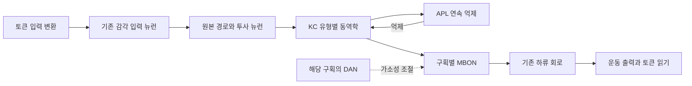

# flyLM 버섯체 적용 조사 및 구현 계획

조사일: 2026-09-09. 기준 구현: `flylm-2/flylm-2-training.ipynb`, `flylm-2/flylm_inference.py`. 본 문서는 구현 계획이며 모델 코드는 변경하지 않았다.

**권고: 기존 MaleCNS 회로 안의 버섯체에 유형별 동역학과 억제 피드백을 먼저 적용하고, 공간 구획을 확인한 뒤 도파민 가소성을 추가한다.** 언어 성능과 생리학적 재현은 독립적으로 평가한다. 버섯체를 언어 전용 기관으로 가정하지 않는다.

## 1. 직접 확인한 현재 상태

공식 [MaleCNS v1.0 다운로드](https://male-cns.janelia.org/download/)의 뉴런 주석 Feather를 내려받아 현재 학습 코드와 동일하게 `status == 'Traced'`로 선택했다. 아래 숫자는 이 파일에서 직접 집계한 결과이며 종 전체의 고정된 세포 수가 아니다.

| 대상 | 식별 기준 | 왼쪽 | 오른쪽 | 합계 |
|---|---|---:|---:|---:|
| 전체 선택 뉴런 | `status == 'Traced'` | — | — | 165,122 |
| Kenyon cell(KC) | `class == 'Kenyon_Cell'` | 2,019 | 2,045 | 4,064 |
| APL | `type == 'APL'` | 1 | 1 | 2 |
| 버섯체 출력 뉴런(MBON) | `class == 'MBON'` | 48 | 49 | 97 |
| PAM/PPL1 도파민 뉴런 후보 | `class == 'DAN'` 및 확인된 PAM/PPL1 명명 범위 | 166 | 166 | 332 |

APL bodyId는 오른쪽 10540, 왼쪽 10977이다. PAM/PPL1 332개는 후보 집합이다. 모든 후보의 버섯체 구획·기능·전달물질을 확인했다는 뜻은 아니다. 최종 구현에는 검토한 정확한 유형과 bodyId 명단을 저장한다.

주석의 SHA-256: `2177e246113e4cfbf1e7772ec37c6da1955ff22e8063d0b1f833101f99a9a3b2`, 크기 14,483,314 bytes. 집계와 개별 뉴런 명단은 [audit JSON](mushroom-body/mb_annotation_audit.json), [inventory CSV](mushroom-body/mb_neuron_inventory.csv)에 있다. `hemibrainType`와 `flywireType`은 대응에 도움이 되지만 일부는 다대다이며 생리학적 동일성을 보장하지 않는다. 선택 집합의 `receptorType`은 모두 비어 있어 이 열에서 시냅스 후 수용체 작용을 얻을 수 없다.

현재 코드는 모든 선택 뉴런과 그 사이의 집계 연결을 보존하도록 작성되어 있다. 따라서 버섯체는 구조상 이미 모델에 들어간다. 다만 이번 조사에서는 약 1GB의 연결 파일과 신경전달물질 파일을 새로 분석하지 않았으므로, 실제 KC–APL 연결 수, 전달물질 부호, 버섯체를 통과하는 활성 경로는 아직 미확인이다.

현재 활동 근거표에는 KC·APL·MBON·PAM/PPL1 유형이 없다. 이들은 미확인 기본값인 연속 동역학을 사용한다. APL의 연속 방식은 문헌과 방향이 맞지만, 근거를 명시적으로 등록해야 한다. KC는 직접 기록 근거와 세부 유형의 대응을 추가해야 한다. MBON과 DAN 전체를 일괄 스파이크로 바꾸지 않는다.

뉴런 상태는 `v, s, a, q` 네 값이다. 토큰당 4 tick이며 ms 단위는 아니다. 연결 강도와 유형별 동역학은 Adam으로 학습된다. 출력은 운동 뉴런에서 읽으며, 현재 버섯체 출력 전용 언어 헤드는 없다.

## 2. 문헌 근거와 설계에 주는 의미

| 근거 | 관측 또는 분석 결과 | 적용할 결정 | 범위와 한계 |
|---|---|---|---|
| [Turner et al., 2008](https://repository.cshl.edu/id/eprint/26143/) | 성체 KC 전세포 기록에서 선택적인 냄새 반응, 빠른 EPSP 감쇠와 높은 발화 역치 등을 제시 | KC의 누적 시간과 역치를 함께 보정 | 특정 냄새·기록 조건의 결과. 모든 KC 세부 유형에 같은 수치를 넣지 않음 |
| [Lin et al., 2014](https://www.nature.com/articles/nn.3660) | KC–APL 피드백을 방해하면 냄새 표현의 희소성이 낮아지고 상관성이 커지며 비슷한 냄새의 학습 구별이 저하 | 실제 KC→APL→KC 연결을 활용한 억제와 제거 실험 | 전체 뇌의 일정 활성 비율 또는 전역 top-k를 지지하지 않음 |
| [Inada et al., 2017](https://pubmed.ncbi.nlm.nih.gov/28728024/) | 주요 KC 유형 간 흥분성과 냄새 처리 특성이 다름 | 유형별 역치·입출력 반응 보정 | MaleCNS의 세부 라벨과 실험 유형의 교차 대응 필요 |
| [Amin et al., 2020](https://pubmed.ncbi.nlm.nih.gov/32955437/) | 비스파이킹 APL의 활동과 KC 억제가 공간적으로 국소적 | APL 단일 상태는 첫 근사로 표시하고 이후 다구획 상태 도입 | 모든 구획이 완전히 독립적이라는 뜻은 아님. 공간 결합도는 검증할 가정 |
| [Li et al., 2020](https://elifesciences.org/articles/62576) | 성체 버섯체 구획, KC·MBON·DAN의 선택적 연결과 재귀 경로 분석 | 구획별 조절과 원본 되먹임 경로 보존 | 다른 개체·성별 데이터의 연결 수를 MaleCNS에 복사하지 않음 |
| [Hige et al., 2015](https://www.janelia.org/publication/heterosynaptic-plasticity-underlies-aversive-olfactory-learning-drosophila) | 냄새와 특정 DAN 자극의 결합이 냄새 특이적 시냅스 약화를 유도. 시간 순서와 구획에 의존 | 한 구획의 KC→MBON 가소성부터 구현하고 자극 순서 대조 | 모든 도파민 작용이 약화라는 주장은 아님 |
| [Handler et al., 2019](https://pubmed.ncbi.nlm.nih.gov/31230716/) | DopR1/DopR2 경로와 사건 순서가 약화·강화 방향에 관여 | 단일 도파민 스칼라와 보편적 STDP 규칙을 피함 | 본 계획의 단순 상태식은 수용체 분자 반응의 완전 재현이 아님 |
| [Takemura et al., 2017](https://elifesciences.org/articles/26975) | 성체 α엽에서 구획 회로와 DAN→MBON의 느린 탈분극 등 분석 | 도파민의 모든 연결을 무조건 삭제하거나 모두 가소성으로 대체하지 않음 | 해당 엽에서 얻은 비율을 전체 뇌에 일반화하지 않음 |
| [Bergmann et al., 2026](https://physoc.onlinelibrary.wiley.com/doi/abs/10.1113/JP290394) | 장시간 KC 과활성 뒤 KC와 APL의 적응이 서로 상충할 수 있음 | 빠른 적응과 느린 항상성 조절을 구분. 고정 목표 활동률 자동 제어는 첫 구현에서 제외 | 장시간 실험을 토큰당 적응과 동일시하지 않음 |

성체 자료를 주근거로 삼는다. 유충 버섯체의 구조나 학습 규칙을 성체 MaleCNS에 그대로 옮기지 않는다. 희소성은 자극·농도·관측 시간·측정 방식에 따라 달라지므로 '항상 5% 발화'를 생리학적 정답으로 두지 않는다. 칼슘 신호의 반응 세포 비율과 매 tick의 스파이크 비율도 구분한다.

## 3. 목표 구조

이 그림은 설명용 부분 경로다. 원본의 다른 입력, 우회 경로, 재귀 연결도 유지한다. 점선은 KC→MBON 시냅스에 대한 조절이며, 모든 DAN→MBON 해부학적 연결을 같은 작용으로 바꾼다는 뜻이 아니다. 버섯체를 모든 토큰이 반드시 통과해야 하는 새 병목으로 만들지 않는다.

## 4. 단계별 구현 계획

### 단계 A — 원본 버섯체와 근거의 대응표 확정

1. 현재 Kaggle 그래프 캐시가 있으면 동일 버전·해시를 먼저 확인해 재사용한다. 없을 때 공식 연결과 전달물질 파일을 준비한다.
2. KC·APL·MBON·PAM/PPL1 후보, 후각 감각 뉴런, KC로 실제 연결되는 투사 뉴런을 식별한다. 현재 주석에서 후각 입력은 `superclass='cb_sensory', class='olfactory'`, DM1_lPN은 `class='ALPN'`이다. ALPN 전체를 자동으로 KC 입력 또는 동일 생리학 유형으로 간주하지 않는다.
3. 원본 연결에서 PN→KC, KC→APL, APL→KC, KC→MBON 및 주변 재귀 경로를 추출하고 좌우를 확인한다. 전체 모델에서는 뉴런과 연결을 제거하지 않는다.
4. 각 역할과 발화 방식에 `source, species, sex, life_stage, experimental_type, MaleCNS_type, mapping_level, uncertainty`를 기록한다. 클래스 수준 근거 전이는 정확한 유형의 직접 기록과 별도로 표시한다.
5. MBON·DAN의 구획 대응을 문헌과 주석 교차표로 작성한다. 여러 구획에 걸친 뉴런에는 다중 소속을 허용한다. 유형명이나 DAN과 연결되었다는 사실만으로 KC→MBON 접점의 위치를 확정하지 않는다.

산출물: `mb_nodes.csv`, `mb_edges.csv`, `mb_type_evidence.json`, `mb_compartment_mapping.csv`, 미확인 항목 목록. 통과 조건: 적용할 모든 bodyId가 원본에 존재하고, 방향·부호·좌우·경계 연결 검사가 통과할 것. 불명확한 연결은 원래 처리와 미확인 상태를 유지한다.

### 단계 B — 가소성 없는 KC–APL 동역학

첫 구현은 기존 네 상태를 유지한다. 근거가 확인된 KC 세부 유형에 적응성 누적·발화 동역학을 적용하고 APL을 명시적인 연속 신호 유형으로 등록한다. KC의 높은 역치만 조절하지 말고 입력 세기, 시냅스 감쇠, 막 시간 상수를 함께 보정한다.

원본 KC→APL과 APL→KC 연결에 유형 또는 연결군별 작은 수의 gain을 적용한다. APL 억제를 별도로 다시 더해 원본 음수 연결과 중복 계산하지 않는다. 부호 근거가 빠진 경우에는 출처가 있는 별도 보정표를 사용하며 원본 전달물질 기록을 덮어쓰지 않는다.

기존 incoming 정규화는 뉴런의 모든 입력을 합쳐 적용된다. 억제가 너무 약하다고 판단하기 전에 정규화된 흥분·억제 전류를 측정한다. 억제 강도의 보정은 공간별 전도도 실측이 아닌 공학적 근사로 기록한다.

APL 하나에 상태 하나를 쓰는 모델은 공간 평균 근사다. 이 단계는 희소 활동과 피드백 방향을 검증하는 최소 모델이며, 국소 억제를 재현했다고 표현하지 않는다. 모든 KC를 같은 역치로 묶거나 top-k·무작위 마스크로 활성 개수를 강제하지 않는다. 언어 손실에 희소성 벌점을 바로 추가하지 않아 회로 효과를 구분한다.

보정 실험에는 투사 뉴런에 정의된 합성 자극을 가하는 검사 경로를 둔다. 이는 기록 전류 주입과 유사한 모델 검사이며 실제 냄새 또는 언어 입력의 생물학적 재현으로 해석하지 않는다. 외부 입력을 잘라낸 소형 버섯체만 검사한 결과는 전체 회로의 결과와 별도로 기록한다.

시간은 자극 지속시간·빈 구간과 적분 간격을 분리한다. 보정된 물리 단위 체계가 준비되기 전에는 tick을 ms라고 부르지 않는다. 국소 MB만 빠르게 substep한다면 경계 입력을 고정하는 근사와 피드백 지연도 명시한다. 정량 생리학 비교에는 일관된 시간 기준이 필요하다.

통과 조건: 전체 침묵이나 지속 포화가 없고, 여러 자극에 선택적인 KC 집합이 반응하며, APL 경로를 억제했을 때 KC 반응이 더 넓어지는 방향을 보정에 쓰지 않은 자극에서도 재현할 것. 문헌의 자극·관측 조건을 확보하면 반응률·적응·지연 곡선의 정량 오차를 사전 정의한다.

### 단계 C — APL의 국소 억제와 구획 정보

현재 `body_pre/body_post/count` 집계 연결만으로는 접점 위치가 소실된다. 국소 모델에는 별도 데이터가 필요하다. 공식 자료는 시냅스 partner 파일 약 6.8GB와 위치·ROI 파일 약 12.7GB를 제공한다. 먼저 가능한 서버 조회로 MB 관련 부분만 얻고, 불가능하면 해당 파일을 한 번 스트리밍 필터링한다. 이 계획 조사에서 이 대용량 자료는 다운로드하지 않았다. [공식 파일 설명](https://male-cns.janelia.org/download/)

시냅스 좌표와 적절한 세부 ROI 또는 형태학적 대응으로 calyx와 엽 구획을 구분한다. `primary_post`가 원하는 MB 세부 구획까지 제공하는지는 스키마와 실제 값을 먼저 확인해야 한다. 큰 neuropil 라벨만 있으면 추가 ROI 매핑이 필요하다.

APL은 동일한 두 뉴런으로 유지하되 뉴런 내부에 구획 상태를 둔다. 각 KC→APL 입력과 APL→KC 출력은 해당 접점 위치의 APL 상태를 사용한다. 구획 간 확산·전기적 결합은 유한한 결합으로 근사하며 민감도 분석을 한다. 구획을 나눈 것을 새 해부학적 뉴런·전기 시냅스 발견으로 표현하지 않는다.

분해한 연결의 시냅스 수 합은 기존 뉴런 쌍의 count와 일치해야 한다. 구획 분해 뒤 입력 정규화를 다시 하여 전체 연결 세기가 의도치 않게 바뀌지 않도록 한다. 원래 집계 연결에서 해당 항을 제거·대체해 이중 전달을 막고, MB 밖 APL 접점도 누락 여부를 확인한다.

통과 조건: 국소 APL 자극의 효과가 위치에 따라 달라지고, 전역 평균 모델과 어떤 차이가 생기는지 확인할 것. 좌표가 없는 연결은 공간 미확인으로 남긴다. 데이터가 준비되지 않으면 단계 B의 '평균 억제 근사'까지만 결과를 주장한다.

### 단계 D — 언어모델 통합과 버섯체 기여 검증

동일한 토크나이저·학습/검증 대화 분할·토큰 노출량으로 현재 모델과 단계 B/C를 비교한다. 기존 검증 기본값인 최대 4쌍·답변 128토큰은 실행 확인용이므로 성능 결론에 쓰지 않는다. 충분한 별도 검증 대화와 길이별 평가를 미리 고정한다.

첫 비교에서 입력 포트와 운동 출력 헤드는 유지한다. KC나 MBON에 토큰을 직접 주입하거나 MBON→어휘 출력 헤드를 더하면 동역학 변경과 효과가 섞인다. 후각 입력만 사용하는 별도 조건은 이후 독립 실험으로 둔다. 이 경우 언어→감각 부호화는 인공 인터페이스임을 표시한다.

학습 순서는 (a) 보정된 회로를 고정한 상태에서 입출력 변환기 학습, (b) 근거 범위 안에서 MB 관련 파라미터를 제한적으로 해제, (c) 필요한 경우 나머지 회로까지 같은 조건으로 비교한다. 각 단계에는 같은 학습 가능 범위를 가진 기존 모델 대조군이 있어야 한다. 전체 학습 모델과 고정 회로 모델의 차이를 MB 개선 효과로 오해하지 않는다.

학습 후 KC 또는 KC→MBON 전달을 차단하는 진단을 한다. 성능이 그대로면 해당 언어 과제에서 MB 경로가 실질적으로 쓰이지 않을 가능성이 있다. 이때도 새 우회 연결을 만들어 성공으로 간주하지 않는다. 차단 결과는 분포 변화 영향이 있으므로 같은 크기·유사 역할의 대조 차단과 함께 해석한다.

### 단계 E — 한 구획의 도파민 가소성

첫 후보는 실험 근거가 많은 γ1pedc 계열이다. [성체 회로 연구](https://elifesciences.org/articles/62576)에서 MBON11은 γ1pedc>α/β로 대응된다. MaleCNS에서도 이름이 존재하지만 해당 접점과 DAN의 구획 대응을 단계 A/C에서 확인한 뒤 대상 bodyId를 확정한다. 이름만으로 PPL1 번호를 추정하지 않는다.

처음에는 한 구획의 기존 KC→MBON 연결에만 가소성 상태를 추가한다. 개념적으로 `w_effective = w_base × bounded_gain(p)`이고, `p`는 최근 KC 활동의 흔적과 해당 구획의 DAN 조절 신호에 의해 변한다. 초기 gain은 1이며 부호를 뒤집지 않는다. 이 식은 Hige/Handler 실험을 설명하기 위해 검증할 근사이며, 초파리의 보편적인 학습 법칙으로 제시하지 않는다.

Hige 방식의 순서 의존적 약화부터 맞춘다. 반대 순서에서의 강화 등은 대응 수용체·회로 조건이 확인된 별도 모델에서 추가한다. 모든 구획에 같은 시간 상수와 방향을 넣지 않는다. DAN 신호를 전 뇌 평균으로 만들거나 모든 KC에 뿌리지 않는다. 반대로 직접 DAN 접점 하나가 없다는 이유만으로 국소 도파민 조절이 없다고 단정하지 않는다. 조절 표적은 직접 연결 정보와 공간적 구획 근거를 함께 사용한다.

첫 가소성 실험은 알려진 자극 결합을 흉내 낸 인공 DAN 자극을 사용한다. 일반 텍스트 생성에서는 기존 회로를 통해 계산된 DAN 상태만 사용한다. 정답 다음 토큰이나 검증 손실을 추론 중 DAN에 넣지 않는다. 언어 손실을 도파민 신호로 변환하는 방식은 별도 공학적 대조군으로만 검토한다.

도파민을 단순 빠른 전류로 처리하던 선택 연결의 의미를 명시적으로 수정한다. 모든 DAN→MBON 연결을 일괄 삭제하지 말고, 느린 탈분극 등 근거 있는 작용은 별도 경로로 보존한다. 같은 작용을 빠른 전류와 조절항으로 중복 계산하지 않는다.

통과 조건: 자극 단독·DAN 단독·정방향 결합·역방향 결합·시간을 떨어뜨린 결합·다른 구획 조절을 비교하여 선택한 논문의 결과 방향을 재현할 것. 단순히 가중치가 변한다는 테스트로 끝내지 않는다. 텍스트 과제에서의 추가 효과는 그다음 독립적으로 평가한다.

## 5. 코드 변경 위치와 상태 계약

| 위치 | 계획된 변경 |
|---|---|
| 학습 노트북 셀 12 | MB 역할·원본 연결·전달물질·교차 데이터 대응표 생성 |
| 셀 14 `ACTIVITY_EVIDENCE` | APL 및 근거가 대응된 KC 유형 등록, 전이 수준과 불확실성 구분 |
| 셀 16 `mixed_neuron_tick`, `dynamics`, `advance` | KC–APL 보정, 선택적 구획 상태 및 동역학 모드 |
| `effective_weights` 및 희소 메시지 계산 | 연결군 gain, 이후 배치별 KC→MBON 가소성 보정 |
| 셀 18 검증 | 회로 자극·제거·가소성 순서 실험 및 수치 일치 검사 |
| 셀 20–21 학습·평가 | MB 진단, 비교 조건 고정, 상태 초기화와 학습 범위 제어 |
| 셀 23–24와 추론 파일 | 새 상태·설정·그래프 메타데이터 저장 및 동일한 추론 동작 |

기본 `mb_mode='off'`는 기존 계산과 일치해야 한다. `kc_apl`, `apl_local`, `mb_plastic`은 제안하는 실험 모드 이름이며 아직 구현되어 있지 않다.

가소성 상태는 전역 파라미터와 분리하여 배치 행별로 가진다. 초기 실험에서는 KC→MBON 기본 가중치를 고정해 Adam과 국소 업데이트가 같은 항을 동시에 바꾸지 않도록 한다. 장기 가중치, 빠른 신경 상태, 국소 가소성 상태의 초기화 정책을 각각 명시한다. 에피소드 시작 시 초기화하고, 같은 에피소드 안에서는 유지한다. 검증은 매 에피소드 같은 초기 조건에서 시작하며 검증 결과가 학습 모델로 되돌아가지 않는다. 지속 학습은 별도 실험이다.

현재 `effective_weights()`는 한 번의 forward에서 계산한 1차원 CSR 가중치를 배치가 공유한다. 배치별 가소성을 도입하면 단순히 이 배열을 in-place로 바꿀 수 없다. 선택 KC→MBON edge에 대한 배치별 보정 메시지를 gather/scatter로 더하거나 별도 구현을 검증한다. 전체 그래프의 거대한 배치별 CSR 복제는 피한다. 필요한 메모리는 대략 배치 크기 × 가소성 edge 수 × 상태 수에 비례한다. 아직 edge 수를 집계하지 않았으므로 VRAM 수치를 단정하지 않는다.

모든 갱신은 입력 상태에서 새 상태를 반환하는 함수로 구현한다. activation checkpoint 재계산 때 가소성을 두 번 적용하는 부작용을 막는다. padding 행에서는 모든 빠른 상태·구획 상태·가소성 상태를 멈춘다. `detach`는 TBPTT 경계에서 기울기만 끊고 값은 유지한다. `no_grad` warmup도 생리학적 상태 갱신 자체를 끄지 않도록 한다.

새 체크포인트에는 모드·근거 버전·bodyId 명단·구획 매핑·시간 단위·상태 형식의 해시를 저장한다. 기존 가중치를 shape가 맞는다는 이유만으로 새 생리 모델에 조용히 로드하지 않는다. 보정 비교는 명시적 변환을 기록하고, 언어 학습 효과 비교는 동일한 시작 조건에서 수행한다.

## 6. 실험표와 판정 기준

| 조건 | 확인할 효과 |
|---|---|
| B0 현재 flyLM-2 | 기준 활동·언어 성능 |
| B1 KC 동역학만 변경 | 유형별 누적·발화 효과 |
| B2 B1 + 보정된 원본 APL 억제 | 억제 피드백의 추가 효과 |
| B3 B2 + 국소 APL | 위치 정보의 추가 효과 |
| B4 B3 + 한 구획 가소성 | 경험 의존적 변화의 추가 효과 |
| B2에서 APL→KC 작용 차단 | 억제 회로의 인과 기여 |
| B2의 활동량을 맞춘 top-k 대조 | 같은 희소도에서도 생물 회로가 다른 표현을 만드는지 |
| 좌우·유형·입출력 차수를 고려한 재배선 대조 | 원본 연결 구조의 기여 |

top-k·재배선·차단은 실험용 대조이며 기본 해부학 모델에 반영하지 않는다. 순차적으로 작은 회로 검사에서 탈락한 조건은 전체 P100 학습으로 확대하지 않는다. 최종 후보는 같은 seed 집합(초기 계획 최소 3개), 데이터 노출량, 학습 가능 범위에서 반복한다. 같은 학습량 비교와 같은 실행 시간 비교는 별도로 보고한다.

생리 지표: 유형별 스파이크 비율, 연속 신호, 자극 창별 반응 세포 비율, 전체 자극 집합에서 한 번도 반응하지 않은 세포 비율, 흥분/억제 전류, 시간 지연, 적응·회복, 자극 간 표현 상관성. 전체 침묵은 희소 코딩 성공으로 세지 않는다. 칼슘 자료와 비교할 때는 관측 신호 변환을 따로 정의한다.

언어 지표: 고정된 검증셋의 response NLL/perplexity, 길이별 문맥 유지와 반복률, 학습에 없던 문맥-응답 연합 과제, 고정 질문에 대한 익명화된 답변 비교. 회로 지표가 좋아지고 언어 성능이 나빠지는 결과도 그대로 보고한다.

구현 검증: 모드 off 일치, 자극 제거 후 상태 변화, batch 독립성, padding 정지, chunk 분할과 전체 실행의 추론 일치, checkpoint 사용 여부에 따른 동작 일치, 저장·복원 뒤 같은 출력. 새 상태가 추가된 뒤 P100 메모리·처리량을 다시 측정한다. 희소 활동만으로 현재 CSR 연산이 자동 가속되지는 않는다.

첫 실험 전에 기준 모델의 seed 변동성을 측정하고, 허용 가능한 언어 성능 손실과 생리 오차를 수치로 고정한다. 관측도 없이 임의의 '성능 향상 10%'나 'KC 5% 활성'을 성공 기준으로 정하지 않는다. MB가 언어 경로에 영향을 주지 않거나 활동이 붕괴하면 해당 단계에서 원인을 조사한다.

## 7. 다음 구현의 범위

우선 단계 A와 B를 완료하고 단계 D의 첫 비교까지 진행하는 것이 적절하다. 이 범위는 기존 네 상태를 최대한 활용하면서 실제 버섯체 억제의 기여를 검증할 수 있다. 단계 C는 시냅스 위치와 구획 데이터가 준비된 뒤, 단계 E는 구획 대응과 순서 의존적 가소성 검사 계획이 확정된 뒤 착수한다.

현재 미확인: 실제 MB edge 수와 NT 부호 분포, 위치 자료의 구획 해상도, 일부 KC 세부 유형의 생리학 대응, 새 상태의 P100 비용, 언어 성능 효과. 이 문서는 위 미확인 사항을 성공으로 가정하지 않는다.
